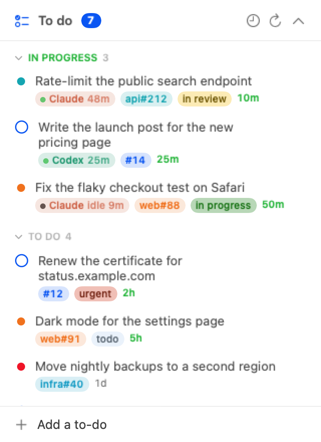

# todo for agents

A to-do list you share with your coding agents. The items are GitHub issues,
Claude Code and Codex read and update them through a small `todo` CLI, and an
always-on-top macOS window shows the list, including which agent is working on
what right now.



- **One list.** Your personal items live in one repo of yours. Every open
  issue assigned to or created by you in any other repo is on the list too.
  Issues you created that someone else holds are listed apart, as "waiting
  on others".
- **Agents keep it current.** They add an issue before they start work, claim
  it, leave progress notes and close it when done.
- **See who is on what.** An item an agent has claimed moves to In progress
  with a badge for that agent. A pulsing green dot means the session did
  something in the last two minutes; a grey dot means it is idle.

## Install

You need macOS 15 or later, the [GitHub CLI](https://cli.github.com) (signed in),
`jq`, and the Xcode command line tools:

```bash
brew install gh jq
gh auth login
xcode-select --install
```

Then:

```bash
git clone https://github.com/RubenHaisma/todo-for-agents.git
cd todo-for-agents
./install.sh
```

The installer:

- writes `~/.config/todo/config`, pointing at the repo for your personal
  items. By default that is `<your login>/todo`; pass another, as in
  `./install.sh you/tasks`. If the repo does not exist yet, it offers to
  create it as a private repo.
- links the CLI to `~/.local/bin/todo`.
- builds `~/Applications/Todo.app` and starts it at login.
- offers to add the agent rules to `~/.claude/CLAUDE.md` and
  `~/.codex/AGENTS.md`.

Re-run it after pulling changes. To remove everything except your settings
and issues, run `./install.sh --uninstall`.

## Tell your agents

Agents only use the list once their instructions say so. `todo rules` prints
a section for `CLAUDE.md` or `AGENTS.md`:

```bash
todo rules >> ~/.claude/CLAUDE.md
todo rules >> ~/.codex/AGENTS.md
```

Edit it to taste. The parts that matter: start every piece of work from an
issue, `todo claim` it, and use `todo` instead of raw `gh issue`, so the window
refreshes at once.

Codex's default sandbox blocks the network. To let it run `todo` without
asking every time, add `prefix_rule(pattern=["todo"], decision="allow")` to
`~/.codex/rules/default.rules`.

## The CLI

```bash
todo                          # the list, one item per line with its ref
todo add "Fix login redirect" -b "What done looks like" -r acme/web
todo note 12 "PR open: acme/web#40"
todo done 12 -m "Shipped in 1.4"
todo show acme/web#88         # the issue with its comments
todo start acme/web#88        # new Claude Code session in your clone, issue as the prompt
todo start 12 --codex         # same, in Codex
todo claim acme/web#88        # this agent session works on it
todo release                  # ...and is done with it
todo claims                   # who works on what
```

A ref is `12` (an issue in your to-do repo), `owner/repo#12`, or an issue URL.
`todo help` lists every command.

`todo done` closes items in your to-do repo. Outside it, it asks for `--force`,
because issues in team repos are usually closed by their reviewer or a merged
pull request.

## How claims work

`todo claim <ref>` records that the current agent session works on `<ref>`.
Each session has one claim; a new claim replaces the old one. `todo done` and
`todo release` drop it.

The CLI tells sessions apart by what the agent sets in its environment:

| Agent | Session | Ends when |
| --- | --- | --- |
| Claude Code | `CLAUDE_CODE_SESSION_ID` | the Claude process exits or the transcript is gone |
| Codex | `CODEX_THREAD_ID` | the rollout file is gone |
| anything else | `TODO_AGENT_NAME` and `TODO_SESSION` | 12 hours after the claim |

Claude Code and Codex claims also lapse after 12 hours in which the session's
transcript did not change (`TODO_CLAIM_TTL`, in seconds). Claims are files in
`~/.local/state/todo/claims`, so nothing about them reaches GitHub.

## The window

- Newest first. The clock button switches to groups per repo. "Waiting on
  others" is always last.
- Each repo has its own colour; labels keep their GitHub colours. The age
  turns green for items updated in the last day.
- Hover a row for the Claude and Codex buttons, or right-click it. "Do now"
  opens a new session in that repo's clone with the issue as the prompt. The
  prompt is filled in, not sent: press Enter there to start.
- Click a section title to fold it. The menu bar item hides the window or quits.
- It refreshes every minute, and at once when `todo` changes something.

`todo start` and Do now find your clones through an index of the git
checkouts under `TODO_ROOTS`, which `todo index` and the installer rebuild.
The window only reads that index, because scanning folders such as
`~/Documents` from the app would ask for folder access.

## Settings

`~/.config/todo/config` is a shell file, read by the CLI:

```bash
TODO_REPO="you/todo"                       # where personal items live
TODO_HIDE="old-org/old-repo"               # repos to leave off the list
TODO_ROOTS="$HOME/Developer $HOME/code"    # where your clones live
TODO_DIR="$HOME"                           # where personal items open
TODO_AGENT="claude"                        # or codex, for todo start
```

## Try the window without GitHub

`demo/todo` is a stand-in CLI with made-up items and claims; it also produced
the screenshot above.

```bash
mkdir -p build
swiftc -O -swift-version 5 -parse-as-library -target "$(uname -m)-apple-macos15.0" app/Todo.swift -o build/Todo
TODO_CLI=$PWD/demo/todo build/Todo
```

Set `TODO_SNAPSHOT=window.png` as well to save a picture of the window once
the list has loaded.

## License

MIT
